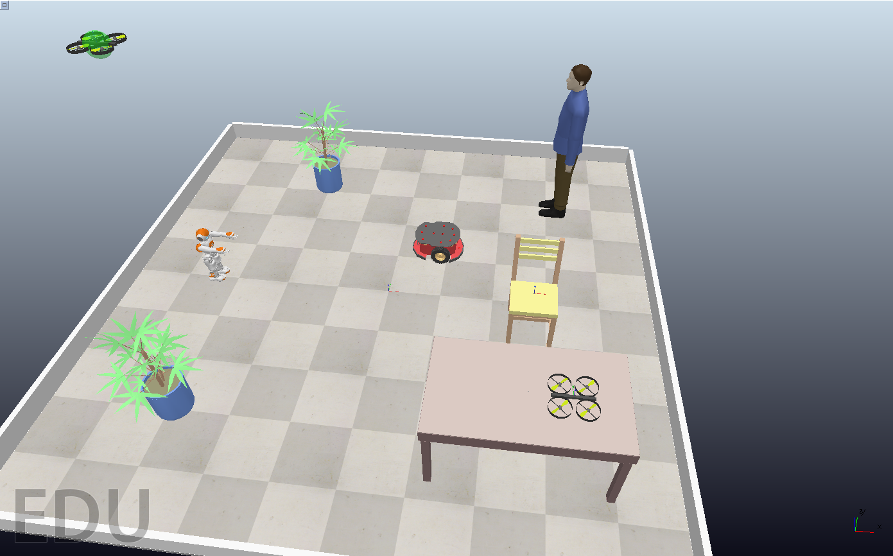
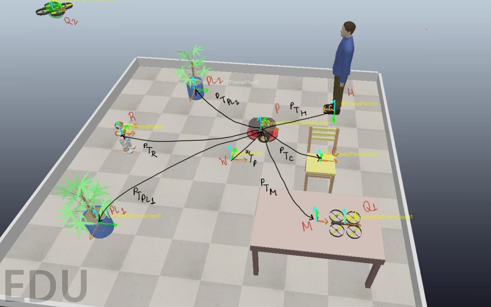
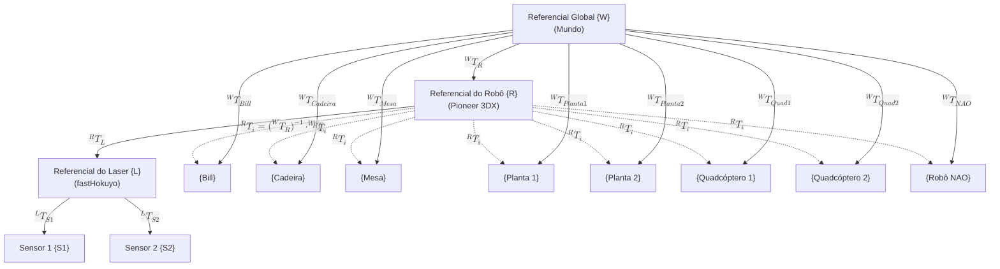
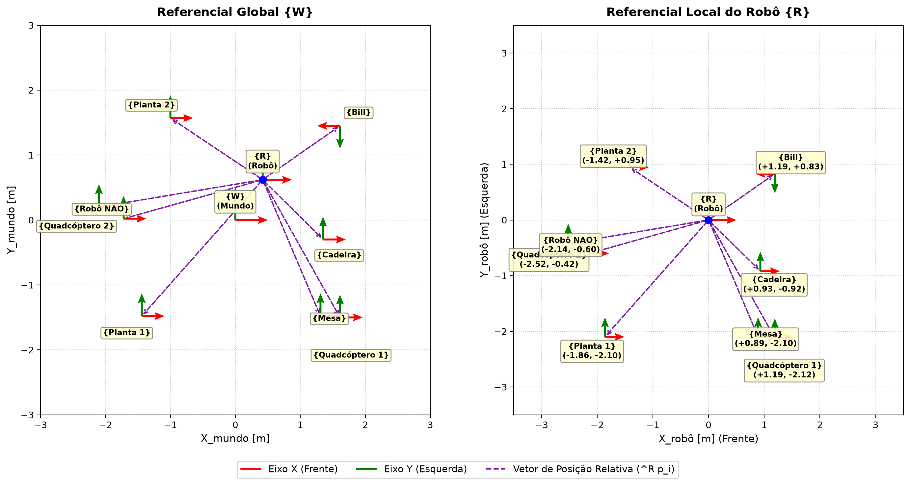
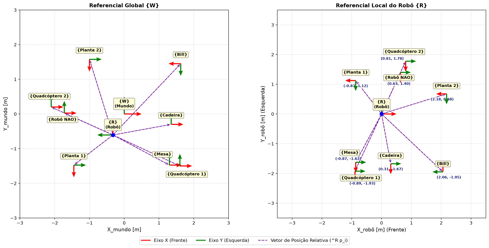
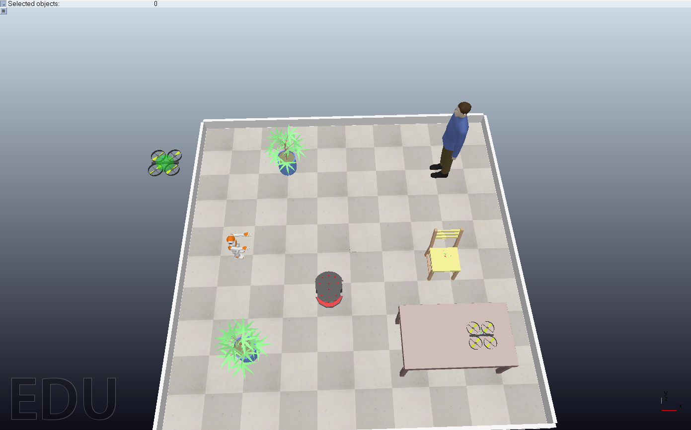
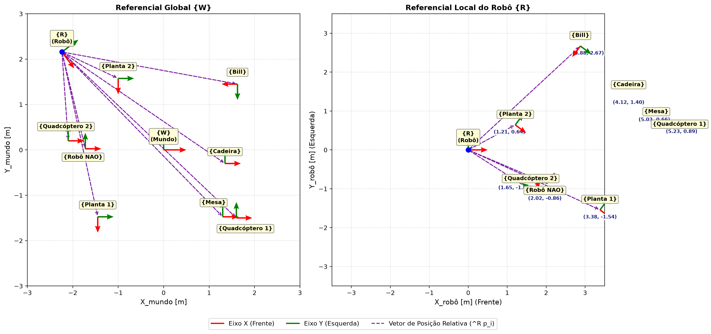
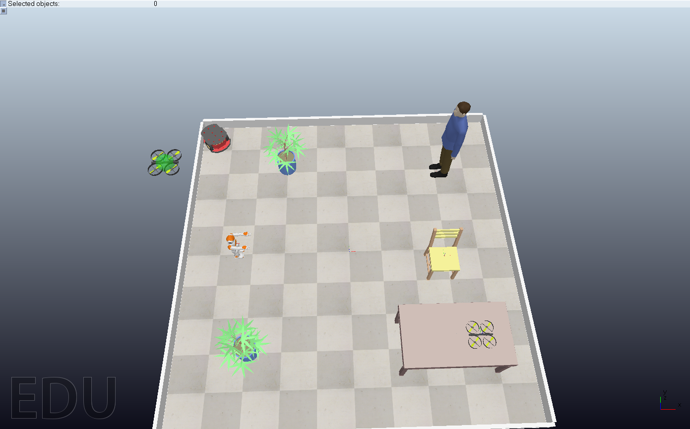
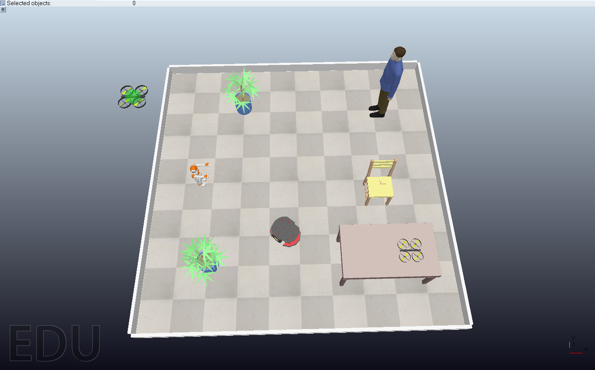
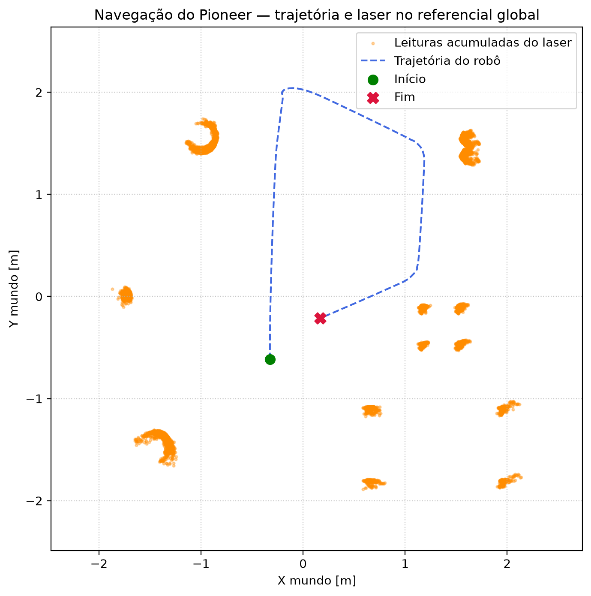

# Trabalho Prático 1 — Ferramentas e Transformações

**Disciplina:** Robótica Móvel  
**Professor:** Prof. Douglas G. Macharet  

---

- Isaac Reyes Alves de Abreu - 2025050342
- Pedro Luiz Silva - 2024006129

---

## Questão 1

Na cena final, temos, distribuídos no ambiente, os seguintes elementos:
1. **Robô Móvel:** Pioneer 3DX.
2. **Elementos Diversos:**
   - **Pessoas/Humanoides:** Bill e Robô NAO.
   - **Mobiliário:** Mesa e Cadeira de jantar.
   - **Vegetação/Decoração:** Dois vasos de planta.
   - **Veículos Aéreos:** Dois Quadcópteros.



---

## Questão 2

Cada entidade na cena possui seu próprio sistema de coordenadas ortonormal afixado, seguindo a convenção de mão direita (com eixo $Z$ perpendicular ao plano de locomoção, $X$ apontando para a frente do elemento e $Y$ para a esquerda).



### Árvore de relacionamentos



- **Transformações Primárias (Globais):** Obtidas diretamente da cena via API ZeroMQ em relação a $\{W\}$.
- **Transformações Relativas ($^R T_i$):** Computadas algebricamente via composição de matrizes homogêneas.
- **Cadeia Cinemática do Sensor:** $\{S_1, S_2\} \to \{L\} \to \{R\} \to \{W\}$.

---

## Questão 3

Podemos descrever qualquer corpo $k$ no plano global $\{W\}$ com o vetor $q_k = [x_k, y_k, \theta_k]^T$.   
A matriz de transformação homogênea $4 \times 4$ associada é:

$$^W T_k = \begin{bmatrix} 
\cos\theta_k & -\sin\theta_k & 0 & x_k \\ 
\sin\theta_k & \cos\theta_k & 0 & y_k \\ 
0 & 0 & 1 & 0 \\ 
0 & 0 & 0 & 1 
\end{bmatrix}$$

Para uma transformação homogênea $T = \begin{bmatrix} R & p \\ \mathbf{0}^T & 1 \end{bmatrix}$, sua inversa exata é:

$$(^W T_R)^{-1} = {}^R T_W = \begin{bmatrix} R_R^T & -R_R^T p_R \\ \mathbf{0}^T & 1 \end{bmatrix} = \begin{bmatrix} 
\cos\theta_R & \sin\theta_R & 0 & -(x_R\cos\theta_R + y_R\sin\theta_R) \\ 
-\sin\theta_R & \cos\theta_R & 0 & x_R\sin\theta_R - y_R\cos\theta_R \\ 
0 & 0 & 1 & 0 \\ 
0 & 0 & 0 & 1 
\end{bmatrix}$$

A posição e orientação de um elemento $i$ qualquer, expressas no referencial do robô $\{R\}$, resultam do produto:

$$^R T_i = {}^R T_W \cdot {}^W T_i = (^W T_R)^{-1} \cdot {}^W T_i$$

Em coordenadas escalares:
- $^R x_i = (x_i - x_R)\cos\theta_R + (y_i - y_R)\sin\theta_R$
- $^R y_i = -(x_i - x_R)\sin\theta_R + (y_i - y_R)\cos\theta_R$
- $^R \theta_i = \theta_i - \theta_R$

Com essas fórmulas, podemos achar a posição de todos os elementos da cena (fornecidos pelo simulador), em relação ao robô.

### Posição dos elementos em relação ao robô

Configuração do Robô: $q_R = [0.4250\text{ m},\, 0.6250\text{ m},\, 0.0000\text{ rad} \ (0.00^\circ)]$

| Elemento | Posição Global $^W q_i$ $(x, y, \theta)$ | Posição Local no Robô $^R q_i$ $(x, y, \theta)$ |
| :--- | :---: | :---: |
| **Bill** | $(+1.62\text{ m}, +1.45\text{ m}, -90.0^\circ)$ | $(+1.19\text{ m}, +0.83\text{ m}, -90.0^\circ)$ |
| **Cadeira** | $(+1.35\text{ m}, -0.30\text{ m}, 0.0^\circ)$ | $(+0.93\text{ m}, -0.92\text{ m}, 0.0^\circ)$ |
| **Mesa** | $(+1.31\text{ m}, -1.48\text{ m}, +90.0^\circ)$ | $(+0.89\text{ m}, -2.10\text{ m}, +90.0^\circ)$ |
| **Planta 1** | $(-1.44\text{ m}, -1.48\text{ m}, 0.0^\circ)$ | $(-1.86\text{ m}, -2.10\text{ m}, 0.0^\circ)$ |
| **Planta 2** | $(-1.00\text{ m}, +1.57\text{ m}, +90.0^\circ)$ | $(-1.42\text{ m}, +0.95\text{ m}, +90.0^\circ)$ |
| **Quadcóptero 1** | $(+1.62\text{ m}, -1.50\text{ m}, 0.0^\circ)$ | $(+1.19\text{ m}, -2.12\text{ m}, 0.0^\circ)$ |
| **Quadcóptero 2** | $(-2.10\text{ m}, +0.20\text{ m}, 0.0^\circ)$ | $(-2.52\text{ m}, -0.42\text{ m}, 0.0^\circ)$ |
| **Robô NAO** | $(-1.72\text{ m}, +0.02\text{ m}, 0.0^\circ)$ | $(-2.14\text{ m}, -0.60\text{ m}, 0.0^\circ)$ |



*Figura 1: Referencial Global $\{W\}$ (à esquerda) e Referencial Local $\{R\}$ (à direita). Eixo X em vermelho, Eixo Y em verde e vetores de translação relativa $^R p_i$ em linha tracejada roxa.*

---

## 6. Questão 4

Foram avaliadas três configurações distintas variando a pose $q_R = [x, y, \theta]$:

### Cena 1:
- Cena: `scenes/TP1-Cena-q4_p1.ttt`
- Pose do robô: $q_R \approx [-0.32\text{ m},\, -0.60\text{ m},\, 180^\circ]$

| Plots | Cena |
| :---: | :---: |
|  |  |

---

### Cena 2
- Cena: `scenes/TP1-Cena-q4_p2.ttt`
- Pose do robô: $q_R \approx [-2.20\text{ m},\, +2.15\text{ m},\, +30^\circ]$

| Plots | Cena |
| :---: | :---: |
|  |  |

---

### Cena 3
- Cena: `scenes/TP1-Cena-q4_p3.ttt`
- Pose do robô: $q_R \approx [-0.25\text{ m},\, -0.98\text{ m},\, -120^\circ]$

| Plots | Cena |
| :---: | :---: |
|  |  |

---

## Questão 5

Na simulação, o sensor Hokuyo é composto internamente por dois sensores de visão (`sensor1` e `sensor2`) que cobrem uma abertura angular de $240^\circ$.

Cada leitura do sensor retorna pontos $^L p = [^L x, ^L y, ^L z]^T$ no referencial local do laser. Para representá-los no referencial inercial do mundo $\{W\}$, aplicamos a composição de transformações:

$$^W \tilde{p} = {}^W T_R \cdot {}^R T_L \cdot {}^L \tilde{p}$$

Onde:
- $^L \tilde{p} = [^L x, ^L y, ^L z, 1]^T$ é a coordenada homogênea do ponto no laser;
- $^R T_L$ é a pose estática do laser em relação ao robô;
- $^W T_R$ é a pose instantânea do robô no mundo;
- $^W \tilde{p} = [^W x, ^W y, ^W z, 1]^T$ é o ponto transformado no referencial global.

### Resultados

| Posição 1 (`q5_p1`) | Posição 2 (`q5_p2`) | Posição 3 (`q5_p3`) |
| :---: | :---: | :---: |
|  |  |  |
| *Pose: $(+0.18\text{ m}, +0.65\text{ m}, 0.0^\circ)$* | *Pose: $(-0.55\text{ m}, -1.95\text{ m}, +90.0^\circ)$* | *Pose: $(-1.90\text{ m}, +1.90\text{ m}, -45.0^\circ)$* |

---

## Questão 6

### Desvio de obstáculos

A navegação autônoma opera em malha fechada dividindo a varredura do laser em três setores angulares:
1. **Setor Frontal** ($\text{índice } N/2$): Detecta proximidade de colisão direta.
2. **Setor Direito** ($\text{índice } N/4$): Avalia espaço livre à direita.
3. **Setor Esquerdo** ($\text{índice } 3N/4$): Avalia espaço livre à esquerda.

A máquina de estados reativa define a velocidade linear $v$ e a velocidade angular $\omega$:
- Se distância frontal $> 2.0\text{ m} \implies v = 0.5\text{ m/s},\ \omega = 0\text{ rad/s}$ (Ir pra frente);
- Se obstáculo à frente e direita livre $\implies v = 0.0\text{ m/s},\ \omega = -30^\circ/\text{s}$ (Girar à direita);
- Se obstáculo à frente e esquerda livre $\implies v = 0.0\text{ m/s},\ \omega = +30^\circ/\text{s}$ (Girar à esquerda);
- Caso contrário $\implies v = 0.0\text{ m/s},\ \omega = 0\text{ rad/s}$ (Parar).

As velocidades angulares das rodas esquerda ($\omega_L$) e direita ($\omega_R$) do Pioneer 3DX são calculadas pela cinemática direta:

$$\omega_L = \frac{v - \frac{\omega \cdot d}{2}}{r}, \qquad \omega_R = \frac{v + \frac{\omega \cdot d}{2}}{r}$$

onde $d = 0.381\text{ m}$ é a distância entre as rodas e $r = 0.0975\text{ m}$ é o raio das rodas.

### Gráfico de obstáculos

Durante os 40s de simulação, a pose $q_R(t)$ foi registrada e todas as leituras válidas do laser foram transformadas para $\{W\}$ e acumuladas em tempo real.



*Figura 2: Trajetória do Pioneer 3DX (linha azul tracejada) partindo de $q_{in\text{í}cio}$ (círculo verde) até $q_{fim}$ (cruz vermelha), com todas as leituras de laser acumuladas em laranja formando o mapa 2D dos obstáculos do ambiente.*

---

## Como rodar

### Pré-requisitos
- Python 3.10+ (ou gerenciador `uv`)
- CoppeliaSim V4.x+ aberto com a cena desejada carregada.

### Comandos de Execução

Todos os comandos devem ser executados a partir do diretório raiz:

<details open>
<summary>
    <b>Usando UV</b>
</summary>

```bash
cd tp1

uv sync

# 1. Questão 3
uv run python main.py --question 3 --output images/questao3.png

# 2. Questão 4
uv run python main.py --question 3 --output images/questao4_p1.png
uv run python main.py --question 3 --output images/questao4_p2.png
uv run python main.py --question 3 --output images/questao4_p3.png

# 3. Questão 5
uv run python main.py --question 5 --output images/questao5_p1_global.png
uv run python main.py --question 5 --output images/questao5_p2_global.png
uv run python main.py --question 5 --output images/questao5_p3_global.png

# 4. Questão 6
uv run python main.py --question 6 --duration 40 --output images/questao6_navegacao_global.png
```

</details>

<details open>
<summary>
    <b>Usando python normal</b>
</summary>

```bash
cd tp1


# 1. Questão 3
python main.py --question 3 --output images/questao3.png

# 2. Questão 4
python main.py --question 3 --output images/questao4_p1.png
python main.py --question 3 --output images/questao4_p2.png
python main.py --question 3 --output images/questao4_p3.png

# 3. Questão 5
python main.py --question 5 --output images/questao5_p1_global.png
python main.py --question 5 --output images/questao5_p2_global.png
python main.py --question 5 --output images/questao5_p3_global.png

# 4. Questão 6
python main.py --question 6 --duration 40 --output images/questao6_navegacao_global.png
```

</details>

---

## 11. Conclusões e Dificuldades Encontradas

### Conclusões
- A representação por matrizes homogêneas em $SE(2)$ e a inversão analítica demonstraram robustez e eficiência para lidar com mudanças de referencial em robótica móvel plana.
- A cadeia cinemática composta $^W T_R \cdot {}^R T_L \cdot {}^L p$ garantiu que medições locais de sensores embarcados fossem integradas coerentemente em um mapa inercial global invariante.
- O controle cinemático diferencial permitiu ao robô navegar autonomamente pelo ambiente desviando de colisões enquanto gerava um mapa cumulativo consistente.

### Principais Dificuldades e Soluções Adotadas
1. **Composição do Sensor Hokuyo no CoppeliaSim:** O sensor `fastHokuyo` divide o feixe em dois sensores de visão (`sensor1` e `sensor2`). Foi necessário ler individualmente cada sub-sensor e transformá-los primeiro para o referencial comum do laser $L$, e em seguida para $\{R\}$ e $\{W\}$.
2. **Formato das Matrizes no CoppeliaSim:** A Remote API ZeroMQ retorna matrizes no formato $3 \times 4$. Foi implementada a função `matriz_sim_para_numpy` para padronização em formato homogêneo $4 \times 4$.
3. **Sobreposição de Rótulos em Plots Densos:** A proximidade de múltiplos objetos gerava sobreposição visual dos textos nos gráficos. Foi desenvolvido um algoritmo de ajuste radial e offsets condicionais em `get_label_offset` para garantir legibilidade dos gráficos.

---

## 12. Referências Bibliográficas

1. **Macharet, D. G.** *Notas de Aula e Códigos de Exemplo da Disciplina de Robótica Móvel*. DCC/UFMG, 2026.
2. **Coppelia Robotics.** *CoppeliaSim User Manual & ZeroMQ Remote API Documentation*. Disponível em: <https://manual.coppeliarobotics.com/>.
