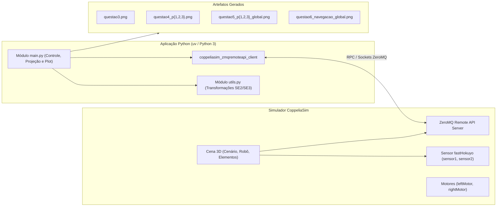
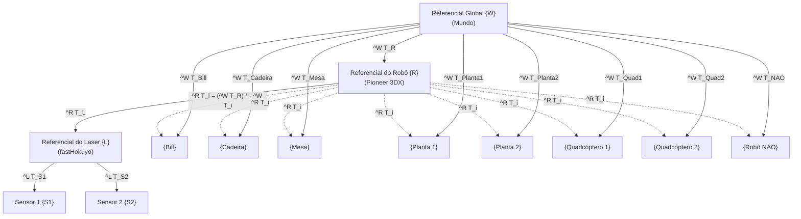
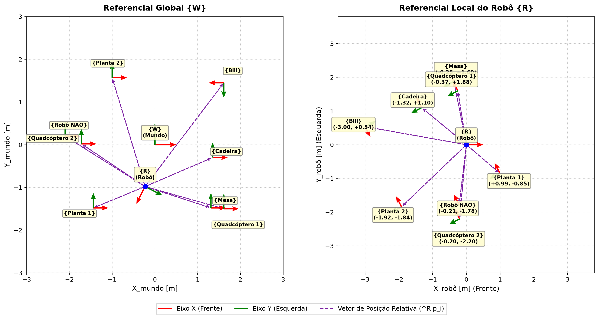
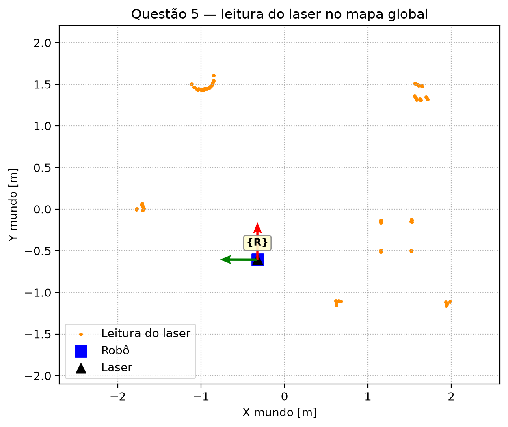
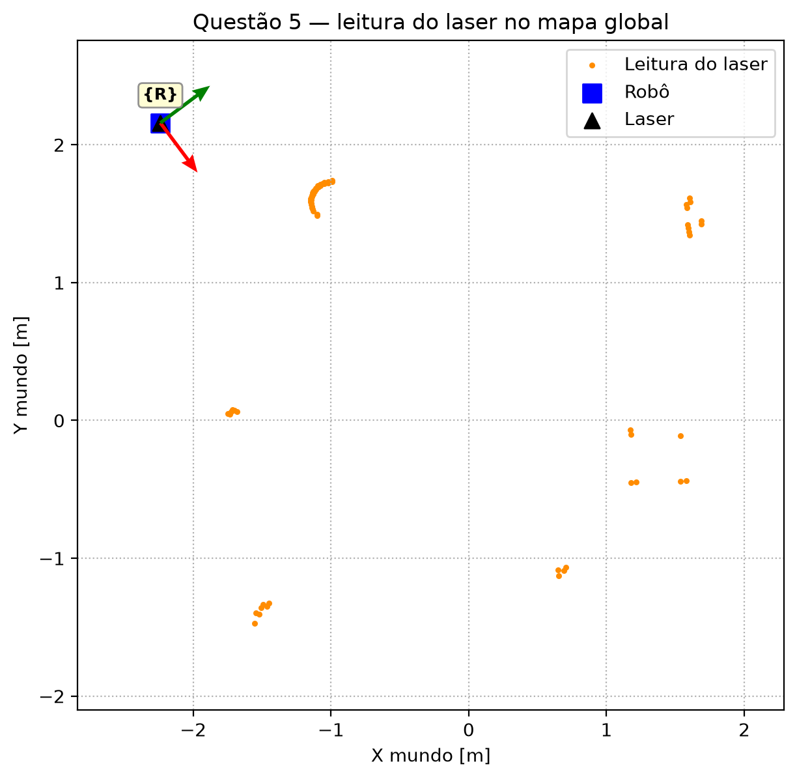
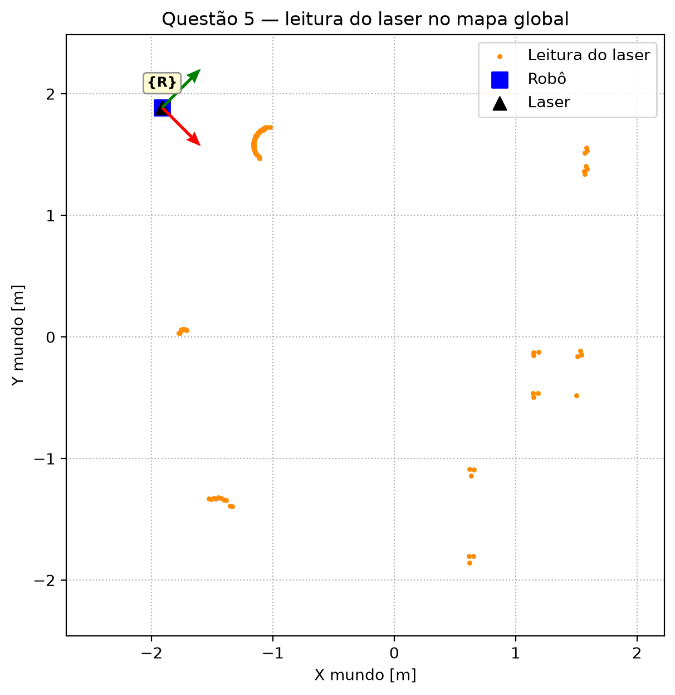

# Trabalho Prático 1 — Ferramentas e Transformações

**Disciplina:** Robótica Móvel (2º Semestre de 2026)  
**Departamento:** Departamento de Ciência da Computação — DCC / ICEx / UFMG  
**Professor:** Prof. Douglas G. Macharet  

---

## 1. Identificação do Aluno

- **Aluno:** PedLuiz <!-- Preencha com o nome completo da dupla/aluno -->
- **Matrícula:** <!-- Preencha com o número de matrícula -->

---

## 2. Visão Geral e Arquitetura do Sistema

O objetivo deste trabalho prático é consolidar os fundamentos teóricos e práticos de **descrição espacial**, **transformações homogêneas em $SE(2) / SE(3)$**, **sensoriamento laser** e **navegação com mapeamento global** utilizando o simulador **CoppeliaSim** integrado à linguagem **Python 3** através da **ZeroMQ Remote API**.

### Diagrama de Comunicação e Fluxo de Dados



---

## 3. Questão 1 — Cenário e Elementos Adicionados

A partir da cena inicial do CoppeliaSim, foram inseridos e distribuídos no ambiente:
1. **Robô Móvel Diferencial:** Pioneer 3DX (`/PioneerP3DX`).
2. **Elementos Diversos:**
   - **Pessoas/Humanoides:** Humanoide Bill (`/Bill`) e Robô NAO (`/NAO`).
   - **Mobiliário:** Cadeira de jantar (`/diningChair`) e Mesa personalizável (`/customizableTable`).
   - **Vegetação/Decoração:** Duas Plantas internas (`/indoorPlant[0]` e `/indoorPlant[1]`).
   - **Veículos Aéreos:** Dois Quadcópteros (`/Quadcopter[0]` e `/Quadcopter[1]`).

Todos os itens foram distribuídos espacialmente cobrindo diferentes quadrantes do plano $XY$ para permitir a validação dos algoritmos de transformação espacial.

---

## 4. Questão 2 — Sistemas de Coordenadas e Grafo de Transformações

Cada entidade na cena possui seu próprio sistema de coordenadas ortonormal afixado, seguindo a convenção de mão direita (com eixo $Z$ perpendicular ao plano de locomoção, $X$ apontando para a frente do elemento e $Y$ para a esquerda).

### Grafo de Relações Espaciais



- **Transformações Primárias (Globais):** Obtidas diretamente da cena via API ZeroMQ em relação a $\{W\}$.
- **Transformações Relativas ($^R T_i$):** Computadas algebricamente via composição de matrizes homogêneas.
- **Cadeia Cinemática do Sensor:** $\{S_1, S_2\} \to \{L\} \to \{R\} \to \{W\}$.

---

## 5. Questão 3 — Matrizes de Transformação Homogênea no Referencial Local

### Modelagem Matemática

A configuração de qualquer corpo $k$ no plano global $\{W\}$ é parametrizada por $q_k = [x_k, y_k, \theta_k]^T$. A matriz de transformação homogênea $4 \times 4$ associada (representação em $SE(2)$ expandida para $SE(3)$) é:

$$^W T_k = \begin{bmatrix} 
\cos\theta_k & -\sin\theta_k & 0 & x_k \\ 
\sin\theta_k & \cos\theta_k & 0 & y_k \\ 
0 & 0 & 1 & 0 \\ 
0 & 0 & 0 & 1 
\end{bmatrix}$$

Para uma transformação homogênea rígida $T = \begin{bmatrix} R & p \\ \mathbf{0}^T & 1 \end{bmatrix}$, sua inversa exata é calculada analiticamente sem inversão matricial numérica custosa:

$$(^W T_R)^{-1} = {}^R T_W = \begin{bmatrix} R_R^T & -R_R^T p_R \\ \mathbf{0}^T & 1 \end{bmatrix} = \begin{bmatrix} 
\cos\theta_R & \sin\theta_R & 0 & -(x_R\cos\theta_R + y_R\sin\theta_R) \\ 
-\sin\theta_R & \cos\theta_R & 0 & x_R\sin\theta_R - y_R\cos\theta_R \\ 
0 & 0 & 1 & 0 \\ 
0 & 0 & 0 & 1 
\end{bmatrix}$$

A posição e orientação do elemento $i$ expressas no referencial do robô $\{R\}$ resultam do produto:

$$^R T_i = {}^R T_W \cdot {}^W T_i = (^W T_R)^{-1} \cdot {}^W T_i$$

Em coordenadas escalares:
- $^R x_i = (x_i - x_R)\cos\theta_R + (y_i - y_R)\sin\theta_R$
- $^R y_i = -(x_i - x_R)\sin\theta_R + (y_i - y_R)\cos\theta_R$
- $^R \theta_i = \theta_i - \theta_R$

### Resultados Numéricos Obtidos na Cena Padrão

Configuração do Robô: $q_R = [0.4250\text{ m},\, 0.6250\text{ m},\, 0.0000\text{ rad} \ (0.00^\circ)]$

| Elemento | Posição Global $^W q_i$ $(x, y, \theta)$ | Posição Local no Robô $^R q_i$ $(x, y, \theta)$ |
| :--- | :---: | :---: |
| **Bill** | $(+1.62\text{ m}, +1.45\text{ m}, -90.0^\circ)$ | $(+1.19\text{ m}, +0.83\text{ m}, -90.0^\circ)$ |
| **Cadeira** | $(+1.35\text{ m}, -0.30\text{ m}, 0.0^\circ)$ | $(+0.93\text{ m}, -0.92\text{ m}, 0.0^\circ)$ |
| **Mesa** | $(+1.31\text{ m}, -1.48\text{ m}, +90.0^\circ)$ | $(+0.89\text{ m}, -2.10\text{ m}, +90.0^\circ)$ |
| **Planta 1** | $(-1.44\text{ m}, -1.48\text{ m}, 0.0^\circ)$ | $(-1.86\text{ m}, -2.10\text{ m}, 0.0^\circ)$ |
| **Planta 2** | $(-1.00\text{ m}, +1.57\text{ m}, +90.0^\circ)$ | $(-1.42\text{ m}, +0.95\text{ m}, +90.0^\circ)$ |
| **Quadcóptero 1** | $(+1.62\text{ m}, -1.50\text{ m}, 0.0^\circ)$ | $(+1.19\text{ m}, -2.12\text{ m}, 0.0^\circ)$ |
| **Quadcóptero 2** | $(-2.10\text{ m}, +0.20\text{ m}, 0.0^\circ)$ | $(-2.52\text{ m}, -0.42\text{ m}, 0.0^\circ)$ |
| **Robô NAO** | $(-1.72\text{ m}, +0.02\text{ m}, 0.0^\circ)$ | $(-2.14\text{ m}, -0.60\text{ m}, 0.0^\circ)$ |

### Gráfico de Referenciais e Vetores Relativos


*Figura 1: Referencial Global $\{W\}$ (à esquerda) e Referencial Local $\{R\}$ (à direita). Eixo X em vermelho, Eixo Y em verde e vetores de translação relativa $^R p_i$ em linha tracejada roxa.*

---

## 6. Questão 4 — Validação em Múltiplas Configurações do Robô

Para comprovar a generalidade da formulação para qualquer translação e rotação do robô, foram avaliadas três configurações distintas variando a pose $q_R = [x, y, \theta]$:

### Caso 1: Posição Central com Rotação Invertida ($180^\circ$ — De Costas)
- Cena: `scenes/TP1-Cena-q4_p1.ttt`
- Pose do robô: $q_R \approx [-0.32\text{ m},\, -0.60\text{ m},\, 180^\circ]$
- **Comportamento observado:** Elementos que estavam à direita do robô no mundo passam a estar à esquerda no referencial $\{R\}$ devido à rotação de $\pi\text{ rad}$.


---

### Caso 2: Posição Superior com Orientação Angular Inclinada ($\approx +30^\circ$)
- Cena: `scenes/TP1-Cena-q4_p2.ttt`
- Pose do robô: $q_R \approx [-2.20\text{ m},\, +2.15\text{ m},\, +30^\circ]$
- **Comportamento observado:** Todo o conjunto de elementos sofre translação e rotação em bloco para o quadrante inferior de $\{R\}$, mantendo as distâncias euclidianas relativas estritamente invariantes.


---

### Caso 3: Posição Inferior com Orientação Inclinada para Baixo ($\approx -120^\circ$)
- Cena: `scenes/TP1-Cena-q4_p3.ttt`
- Pose do robô: $q_R \approx [-0.25\text{ m},\, -0.98\text{ m},\, -120^\circ]$
- **Comportamento observado:** O eixo frontal do robô aponta para o canto inferior direito no mundo, projetando os objetos à frente e atrás de forma coerente no plano $\{R\}$.



---

## 7. Questão 5 — Projeção Global das Leituras do Laser Hokuyo

O sensor Hokuyo (`/PioneerP3DX/fastHokuyo`) é composto internamente por dois sensores de visão (`sensor1` e `sensor2`) que cobrem uma abertura angular de $240^\circ$.

### Cadeia Cinemática de Percepção

Cada leitura do sensor retorna pontos $^L p = [^L x, ^L y, ^L z]^T$ no referencial local do laser. Para representá-los no referencial inercial do mundo $\{W\}$, aplica-se a composição de transformações:

$$^W \tilde{p} = {}^W T_R \cdot {}^R T_L \cdot {}^L \tilde{p}$$

Onde:
- $^L \tilde{p} = [^L x, ^L y, ^L z, 1]^T$ é a coordenada homogênea do ponto no laser;
- $^R T_L$ é a pose estática do laser em relação ao chassi do robô;
- $^W T_R$ é a pose instantânea do robô no mundo;
- $^W \tilde{p} = [^W x, ^W y, ^W z, 1]^T$ é o ponto transformado no referencial global.

### Resultados da Projeção em Três Poses do Robô

As cenas `TP1-Cena-q5_p1.ttt`, `TP1-Cena-q5_p2.ttt` e `TP1-Cena-q5_p3.ttt` foram avaliadas:

| Posição 1 (`q5_p1`) | Posição 2 (`q5_p2`) | Posição 3 (`q5_p3`) |
| :---: | :---: | :---: |
|  |  |  |
| *Pose: $(+0.18\text{ m}, +0.65\text{ m}, 0.0^\circ)$* | *Pose: $(-0.55\text{ m}, -1.95\text{ m}, +90.0^\circ)$* | *Pose: $(-1.90\text{ m}, +1.90\text{ m}, -45.0^\circ)$* |

**Análise:** Em todas as poses, as nuvens de pontos em laranja alinham-se precisamente com as posições reais dos obstáculos no ambiente global (pernas da mesa, troncos das plantas, contorno dos robôs e cadeiras), comprovando a exatidão das matrizes $^R T_L$ e $^W T_R$.

---

## 8. Questão 6 — Navegação Reativa e Mapeamento Global Integrado

### Algoritmo de Desvio de Obstáculos e Cinemática Diferencial

A navegação autônoma opera em malha fechada dividindo a varredura do laser em três setores angulares:
1. **Setor Frontal** ($\text{índice } N/2$): Detecta proximidade de colisão direta.
2. **Setor Direito** ($\text{índice } N/4$): Avalia espaço livre à direita.
3. **Setor Esquerdo** ($\text{índice } 3N/4$): Avalia espaço livre à esquerda.

A máquina de estados reativa define a velocidade linear $v$ e a velocidade angular $\omega$:
- Se distância frontal $> 2.0\text{ m} \implies v = 0.5\text{ m/s},\ \omega = 0\text{ rad/s}$ (Avançar);
- Se obstáculo à frente e direita livre $\implies v = 0.0\text{ m/s},\ \omega = -30^\circ/\text{s}$ (Girar no próprio eixo à direita);
- Se obstáculo à frente e esquerda livre $\implies v = 0.0\text{ m/s},\ \omega = +30^\circ/\text{s}$ (Girar no próprio eixo à esquerda);
- Caso contrário $\implies v = 0.0\text{ m/s},\ \omega = 0\text{ rad/s}$ (Parar).

As velocidades angulares das rodas esquerda ($\omega_L$) e direita ($\omega_R$) do Pioneer 3DX são computadas pela cinemática direta:

$$\omega_L = \frac{v - \frac{\omega \cdot d}{2}}{r}, \qquad \omega_R = \frac{v + \frac{\omega \cdot d}{2}}{r}$$

onde $d = 0.381\text{ m}$ (bitola entre rodas) e $r = 0.0975\text{ m}$ (raio das rodas).

### Acumulação Incremental e Gráfico Consolidado

Durante o deslocamento contínuo de 40 segundos, a pose $q_R(t)$ é registrada e todas as leituras válidas do laser são transformadas para $\{W\}$ e acumuladas em tempo real.


*Figura 2: Trajetória do Pioneer 3DX (linha azul tracejada) partindo de $q_{in\text{í}cio}$ (círculo verde) até $q_{fim}$ (cruz vermelha), com todas as leituras de laser acumuladas em laranja formando o mapa 2D dos obstáculos do ambiente.*

---

## 9. Detalhes de Implementação e Estrutura de Código

O código-fonte foi estruturado de forma modular e limpa:

- **[`utils.py`](utils.py):**
  - `homogeneousTransformationMatrix(x, y, theta)`: Constrói matrizes homogêneas $4 \times 4$ em $SE(2) / SE(3)$.
  - `inverseHomogeneousMatrix(T)`: Inversão analítica $\begin{bmatrix} R^T & -R^T p \\ \mathbf{0}^T & 1 \end{bmatrix}$.
  - `transformToRobotFrame(T_world_robot, T_world_object)`: Composição $^R T_{obj} = (^W T_R)^{-1} \cdot {}^W T_{obj}$.
  - `plot_frame(origin, orientation_rad, ...)`: Renderização visual dos eixos de coordenadas ($X=$ Vermelho, $Y=$ Verde).
  - `get_label_offset(...)`: Algoritmo de posicionamento dinâmico de rótulos evitando sobreposição de texto nos gráficos.

- **[`main.py`](main.py):**
  - `HokuyoSensorSim`: Classe wrapper que encapsula a leitura dos submódulos `sensor1` e `sensor2` do laser Hokuyo.
  - `transform_laser_points_to_world(points_laser, T_R_L, T_W_R)`: Transformação em lote das coordenadas do sensor para o mundo.
  - `run_navigation(sim, output, duration)`: Laço de controle cinemático diferencial com acumulação incremental do mapa global.
  - `main()`: Interface de linha de comando (`argparse`) unificada para execução das Questões 3, 4, 5 e 6.

---

## 10. Instruções de Execução

### Pré-requisitos
- Python 3.10+ (ou gerenciador `uv`)
- CoppeliaSim V4.x+ aberto com a cena desejada carregada.

### Comandos de Execução

Todos os comandos devem ser executados a partir do diretório `tp1`:

```bash
cd tp1

# 1. Questão 3 — Referenciais e Transformações na Cena Padrão (TP1-Cena.ttt)
uv run python main.py --question 3 --output images/questao3.png

# 2. Questão 4 — Validação em Diferentes Poses (Abrir cada cena q4_p*.ttt correspondente)
uv run python main.py --question 3 --output images/questao4_p1.png
uv run python main.py --question 3 --output images/questao4_p2.png
uv run python main.py --question 3 --output images/questao4_p3.png

# 3. Questão 5 — Laser no Referencial Global (Abrir cada cena q5_p*.ttt correspondente)
uv run python main.py --question 5 --output images/questao5_p1_global.png
uv run python main.py --question 5 --output images/questao5_p2_global.png
uv run python main.py --question 5 --output images/questao5_p3_global.png

# 4. Questão 6 — Navegação Autônoma e Mapeamento Incremental (40 s de simulação)
uv run python main.py --question 6 --duration 40 --output images/questao6_navegacao_global.png
```

---

## 11. Conclusões e Dificuldades Encontradas

### Conclusões
- A representação por matrizes homogêneas em $SE(2)$ e a inversão analítica demonstraram robustez e eficiência para lidar com mudanças de referencial em robótica móvel plana.
- A cadeia cinemática composta $^W T_R \cdot {}^R T_L \cdot {}^L p$ garantiu que medições locais de sensores embarcados fossem integradas coerentemente em um mapa inercial global invariante.
- O controle cinemático diferencial permitiu ao robô navegar autonomamente pelo ambiente desviando de colisões enquanto gerava um mapa cumulativo consistente.

### Principais Dificuldades e Soluções Adotadas
1. **Composição do Sensor Hokuyo no CoppeliaSim:** O sensor `fastHokuyo` divide o feixe em dois sensores de visão (`sensor1` e `sensor2`). Foi necessário ler individualmente cada sub-sensor e transformá-los primeiro para o referencial comum do laser $L$, e em seguida para $\{R\}$ e $\{W\}$.
2. **Formato das Matrizes no CoppeliaSim:** A Remote API ZeroMQ retorna matrizes no formato $3 \times 4$. Foi implementada a função `matriz_sim_para_numpy` para padronização em formato homogêneo $4 \times 4$.
3. **Sobreposição de Rótulos em Plots Densos:** A proximidade de múltiplos objetos gerava sobreposição visual dos textos nos gráficos. Foi desenvolvido um algoritmo de ajuste radial e offsets condicionais em `get_label_offset` para garantir legibilidade dos gráficos.

---

## 12. Referências Bibliográficas

1. **Siegwart, R., Nourbakhsh, I. R., & Scaramuzza, D.** *Introduction to Autonomous Mobile Robots*. MIT Press, 2nd Edition, 2011.
2. **Craig, J. J.** *Introduction to Robotics: Mechanics and Control*. Pearson, 3rd Edition, 2005.
3. **Coppelia Robotics.** *CoppeliaSim User Manual & ZeroMQ Remote API Documentation*. Disponível em: <https://manual.coppeliarobotics.com/>.
4. **Macharet, D. G.** *Notas de Aula e Códigos de Exemplo da Disciplina de Robótica Móvel*. DCC/UFMG, 2026.
